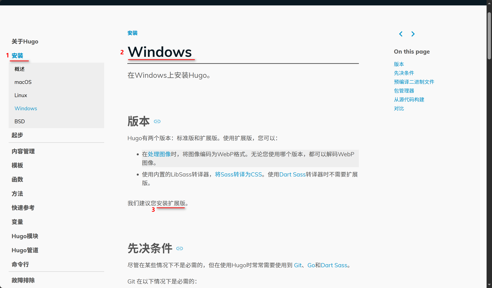
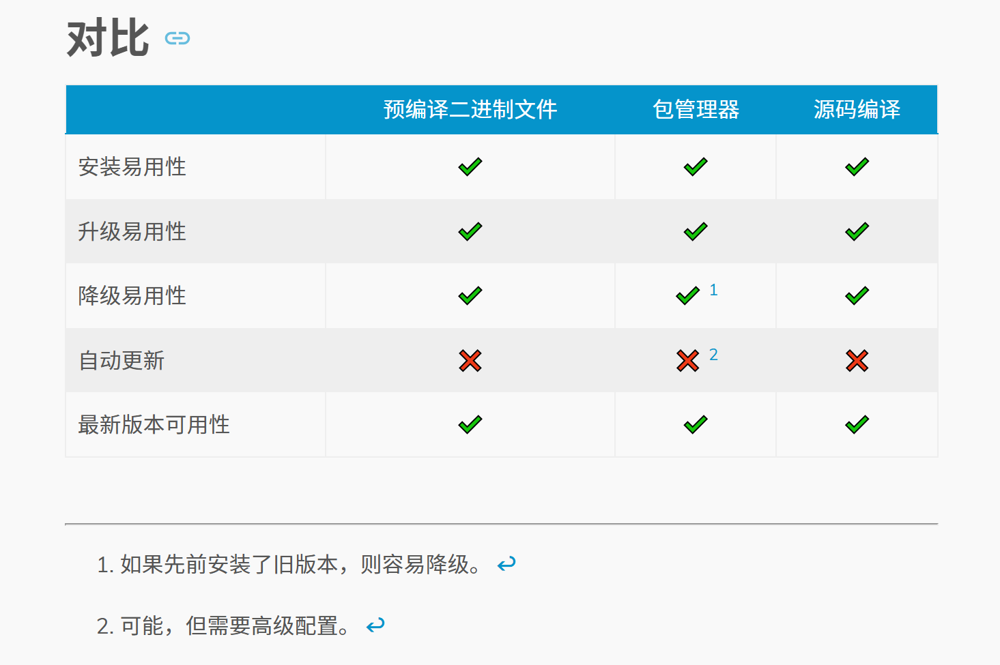
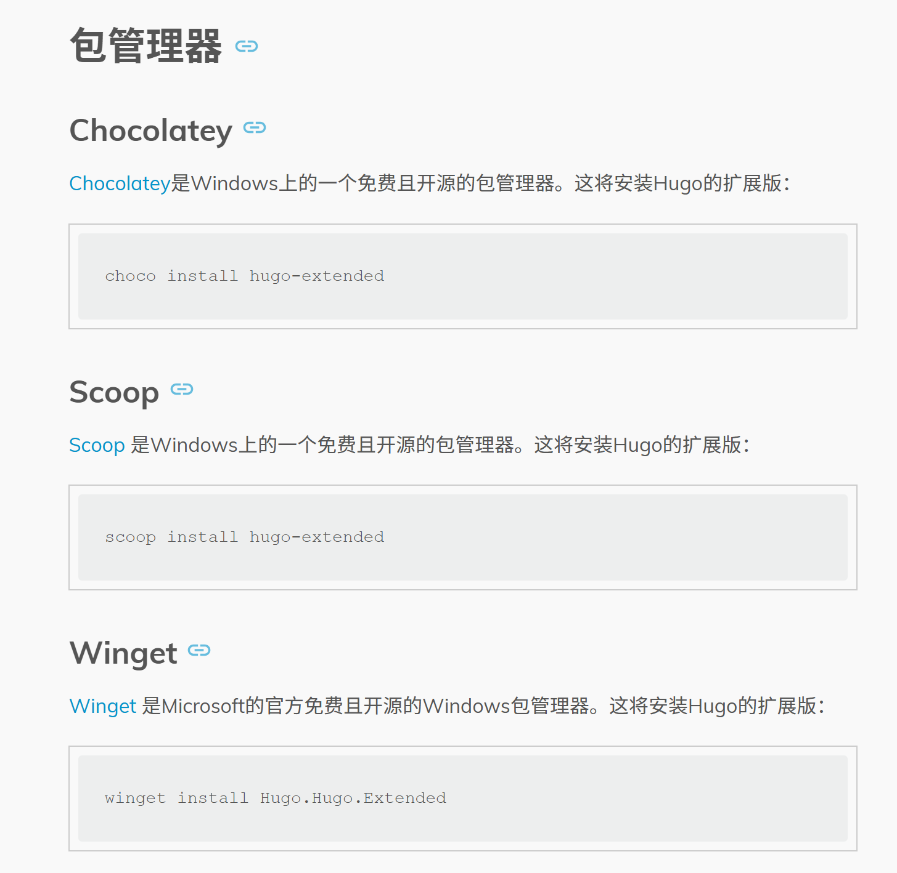
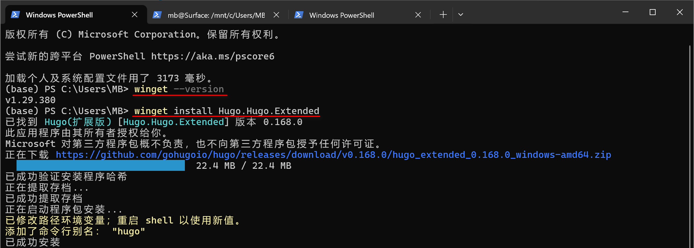
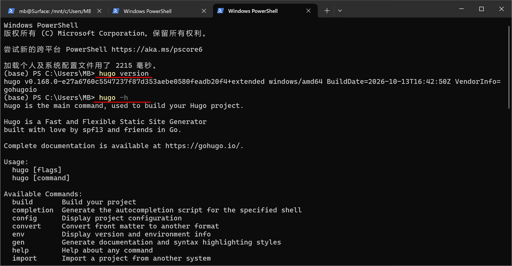
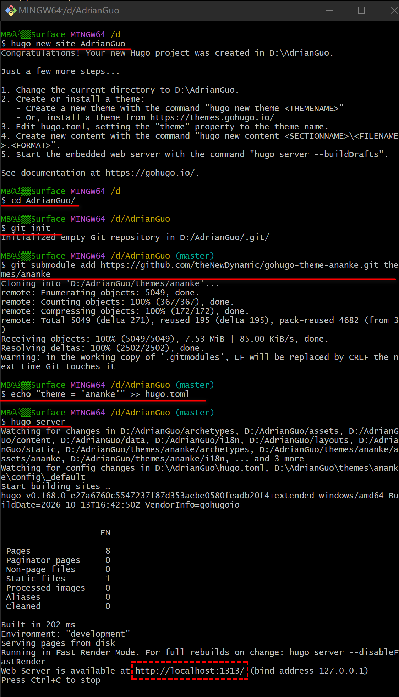
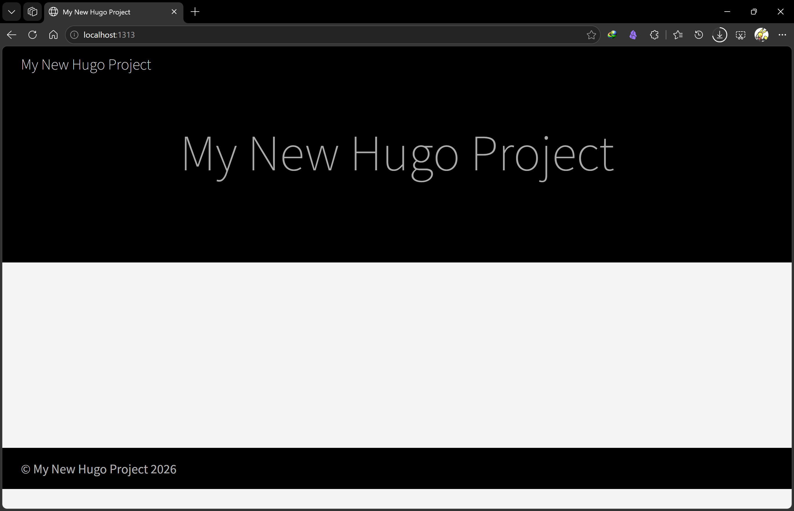
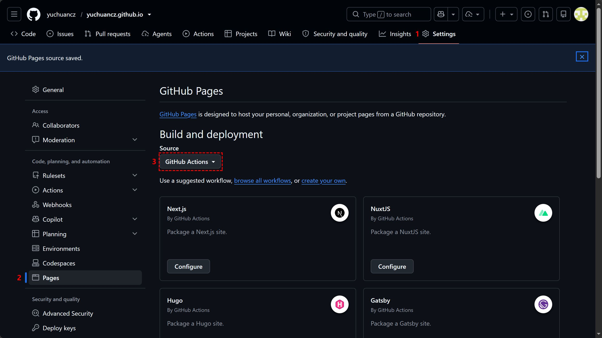

## 首先介绍安装平台及需要的软件
在windows系统上进行个人博客网站的配置。需下载的软件有 Hugo 和 git，网页端使用 GitHub。
网站工作整体的流程是：
```
本地 Markdown
    ↓ git push
GitHub
    ↓ GitHub Actions
Hugo 构建
    ↓
GitHub Pages
    ↓
https://your_username.github.io
```
## Hugo安装
1. 软件版本，选择 Hugo 拓展版。介绍 Hugo 安装的网址是 https://hugo.opendocs.io/installation/windows/ 。


有三种安装方式，选择包管理器安装方法。


网站上展示了三种包管理器，我们使用 WinGet 进行安装，因为这是 win 10 系统自带的，只要有Microsoft Store 就有 WinGet。

2. 在终端中选择 Windows PowerShell，使用 `winget --version` 查看 WinGet版本。确认有WinGet后。使用 `winget install Hugo.Hugo.Extended` 命令安装 Hugo 拓展版。


输入 `hugo version` 查看 hugo 是否安装好，`hugo -h` 查看使用帮助。


## Hugo 网页配置
因为Hugo官方不建议使用 PowerShell 或 Windows PowerShell，因此接下来使用 git bash 进行配置 Hugo 创建网站。

没有 git bash 需要下载安装 git，下载地址： https://git-scm.com/install/windows 。后续同步本地文章到 GitHub 时需使用 git，这是安装 git 的主要目的。git bash 只是顺便用下。

我选择在 D 盘进行配置，这部分内容对应 Hugo 的快速入门部分，对应网址是： https://hugo.opendocs.io/getting-started/quick-start/ 。

1. 使用 `hugo new site AdrianGuo`为项目创建主目录结构，`AdrianGuo` 改为你自己想起的名称。然后输入下列命令。
```bash
cd AdrianGuo  // 进入项目目录
git init      // 初始化 git 仓库
git submodule add https://github.com/theNewDynamic/gohugo-theme-ananke.git themes/ananke     // 下载 ananke 主题
echo "theme = 'ananke'" >> hugo.toml // 将使用主题写入配置文件
hugo server   // 启动 hugo 服务器
```



2. 复制 `http://localhost:1313` 网址进浏览器搜索栏，即可查看配置好的网页。按下 `Ctrl + C` 停止 Hugo 的开发服务器。


这样一个单机版的网页就制作好了，接下来需要进行托管和部署到 GitHub 上。

## 与 GitHub Pages搭配使用
之所以使用 GitHub Pages，主要关注以下几点：
* 可以使用 GitHub 作为文章的备份仓库，每次修改，提交都有历史记录。
* 将文章上传到 GitHub 之后，GitHub Pages 会自动部署、配置 Hugo，无需关心细节实现。

### 配置步骤
1. 先在 GitHub 上新建一个 git 仓库，名称为：`your-username.github.io`，这里的 `your-username` 需要与你自己的用户名一致，这样后续才能访问 https://your_username.github.io 这个较短的域名。我这里已经建过同名仓库所以有红色警告，正常未建立过同名仓库是绿色的。
2. 仓库 `Configuration` 中的可见性选为 `Public`。


3. 设置 GitHub Pages 的 Build and deployment 为 **`GitHub Actions`** 发布方式。这个更改是即时生效的，没有保存按钮。


4. 接下来在本地文件夹中添加 GitHub 的工作流配置。在项目主文件夹下新建`.github\workflows\hugo.yml`文件，填充以下内容：
```yml
# 用于构建和部署Hugo网站到GitHub Pages的示例工作流程
name: Deploy Hugo site to Pages
on:
  # 在目标为默认分支的推送上运行
  push:
    branches:
      - main
  # 允许您手动从“Actions”标签运行此工作流程
  workflow_dispatch:
  
# 设置GITHUB_TOKEN的权限，以允许部署到GitHub Pages
permissions:
  contents: read
  pages: write
  id-token: write
  
# 仅允许一个并发部署，跳过在进行中的运行与最新排队的运行之间排队的运行。
# 但是，请不要取消进行中的运行，因为我们希望这些生产部署能够完成。
concurrency:
  group: pages
  cancel-in-progress: false

# 默认使用bash
defaults:
  run:
    shell: bash

jobs:
  # 构建作业
  build:
    runs-on: ubuntu-latest
    steps:
      # 检出
      - name: Checkout
        uses: actions/checkout@v4
        with:
          submodules: recursive
          fetch-depth: 0

      - name: Setup Hugo
        uses: peaceiris/actions-hugo@v3
        with:
          hugo-version: '0.168.0'
          extended: true

      # 设置页面
      - name: Setup Pages
        id: pages
        uses: actions/configure-pages@v5

      - name: Setup Node.js
        uses: actions/setup-node@v4
        with:
          node-version: '22'

      - name: Install Node.js dependencies
        run: npm ci

      # 使用 Hugo 构建
      - name: Build with Hugo
        env:
          HUGO_ENVIRONMENT: production
          HUGO_ENV: production
        run: hugo --gc --minify

      # 上传构建产物
      - name: Upload artifact
        uses: actions/upload-pages-artifact@v3
        with:
          path: ./public

  # 部署作业
  deploy:
    environment:
      name: github-pages
      url: ${{ steps.deployment.outputs.page_url }}
    runs-on: ubuntu-latest
    needs: build
    steps:
      - name: Deploy to GitHub Pages
        id: deployment
        uses: actions/deploy-pages@v4
```

5. 修改`hugo.toml`配置基础的网页，`hugo.toml`在项目的主文件夹下。没有的话可新建，以下内容需修改为对应自己的。
```toml
	baseURL = 'https://yuchuancz.github.io/'
	title = '雨川的 BLOG'
	locale = 'zh-cn'
	theme = 'ananke'
```
6. 在主项目文件夹下添加 .gitignore 文件，将无需上传到 GitHub 的文件夹写在里面，阻止 Git 跟踪。如果这些目录之前已经被 Git 跟踪，即在添加`.gitignore`文件之前已经将仓库同步到 GitHub 上，则再添加 `.gitignore` 并不会停止跟踪，需要另外处理。
```txt
# Hugo 生成的本地网站文件，因为 GitHub 会自动部署，所以不需要本地文件
/public/
/resources/
.hugo_build.lock

# 操作系统文件
Thumbs.db
.DS_Store
  
# 编辑器配置（按需保留）
.vscode/

# Obsidian 本地配置和回收站
.obsidian/
.trash/
  
# hugo命令
hugo.exe
```
7. 将本地 Hugo 文件目录与远程仓库关联 
```bash
# 关联远程仓库
# 如果不成功需配置本机与GitHub的ssh密钥，或者使用https 链接关联仓库。
git remote add origin git@github.com:yuchuancz/yuchuancz.github.io.git 

git branch -M main //更改分支名
# 提交并推送 
git add . 
git commit -m "Deploy Hugo to GitHub" 
git push -u origin main //初次使用关联远程与本地，后续提交直接使用 git push。
```

 执行完上述命令后，在 GitHub 仓库的`action`页面，点击构建好的工作流。可以在其中找到GitHub Pages 构建的网页地址，点击即可访问构建好的个人博客。或者一般的，个人网站地址为： https://your-username.github.io ，点击即可查看联网的个人博客。


以上就是使用Hugo + GitHub Pages 进行个人网站配置的流程。完成配置后我们就可以通过链接来访问个人 BLOG。目前网页是没有内容的，页面也比较简陋，后续还需要更换主题和上传内容。

## 配置建议与踩过的坑

* 需要配置或新建的文件有：
	* `.github\workflows\hugo.yml`：GitHub 的工作流自动部署配置文件。
	* `hugo.toml`：Hugo 配置文件。
	* `.gitignor`：不想上传到 GitHub 上的文件。
	
* hugo.yml 文件中需注意`hugo-version`与本地 Hugo 的 `version`匹配，GitHub Actions 会安装该版本。版本太低会导致安装版本与 Ananke 主题版本不兼容。

